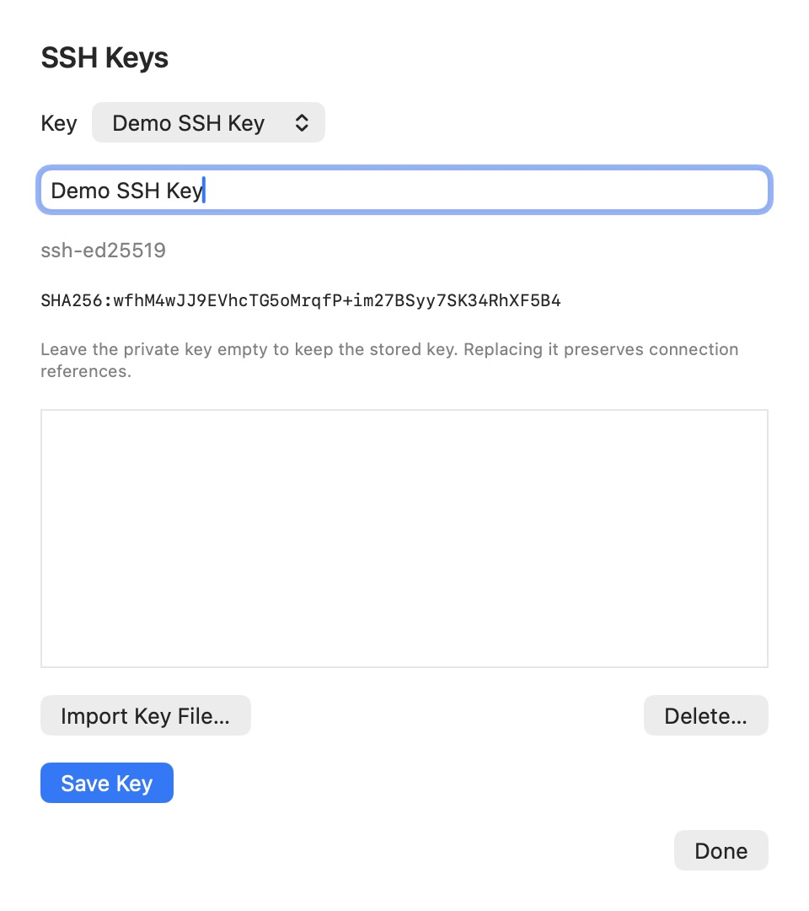
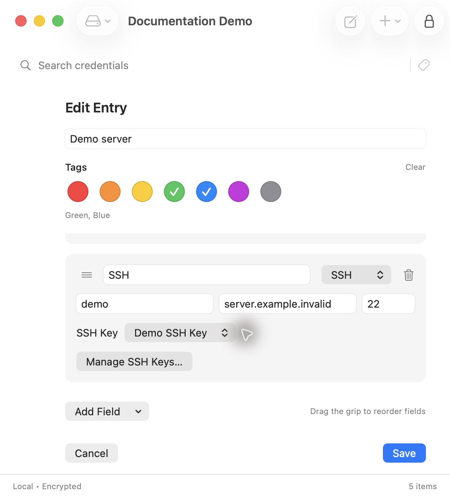
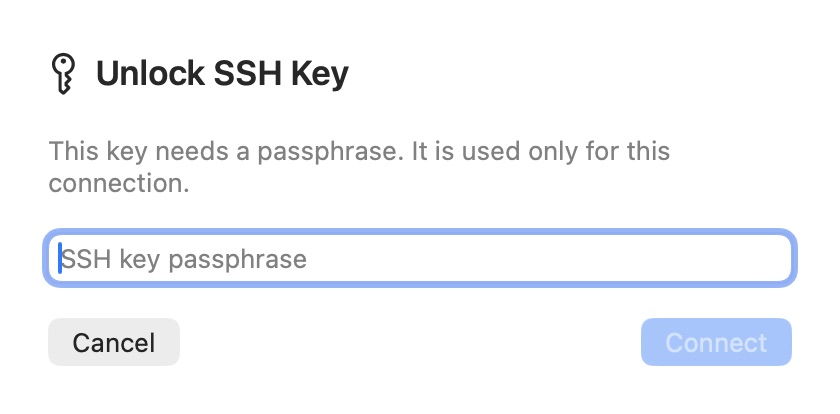

# SSH private keys

Status: implemented and current in version 2.1.1.

## Recommendation

SSH private-key material is stored as a reusable encrypted vault object and is
exposed to OpenSSH through a per-connection in-memory agent. The implementation
never writes a private-key file.

Each connection uses a private runtime directory containing:

```text
<private runtime directory>/Keepy/connection-<random UUID>/agent.sock
<private runtime directory>/Keepy/connection-<random UUID>/identity.pub
```

`identity.pub` contains only the selected public key and makes that key an
explicit OpenSSH identity even when host-specific `~/.ssh/config` rules differ.
The private key remains in memory. Each owner-only socket exposes one selected
key, and both runtime files disappear when the terminal session exits, after a
bounded timeout, when the vault locks, or when the process exits. The vault
stores:

- the OpenSSH private-key document;
- public key, algorithm, comment, and fingerprint metadata;
- the encrypted OpenSSH document unchanged when the source key has a
  passphrase.

## User workflow

1. Create or import a named private key in Vault → SSH Keys.
2. Store an SSH field with user, address, optional port, and the key reference.
3. Use **Connect via SSH**. Encrypted keys request a masked passphrase in-app.
4. The app starts an owner-only one-key agent and launches the system `ssh`
   executable in the preferred terminal with direct arguments,
   `IdentityAgent=<socket>`, `IdentityFile=<public identity>`,
   `IdentitiesOnly=yes`, and `ForwardAgent=no`.
5. The normal OpenSSH host-key and authentication prompts remain interactive.
   If `ssh` exits with an error, the terminal keeps the original output visible
   until Enter is pressed.

On macOS, Terminal.app opens a short-lived owner-only command file that deletes
itself before directly executing the bundled Rust service's SSH helper. The
file contains connection metadata but no private-key material or passphrase.
The helper marks SSH completion in its private directory so the agent can stop
without waiting for the entire Terminal application to quit.



*Stored keys expose metadata here. Keep the private-key input empty when renaming a key.*



*A connection field refers to a stored key; it does not duplicate the private key.*



*Encrypted keys prompt for a passphrase for each connection. The demo uses a reserved host.*

## Security properties and limitations

An agent prevents accidental private-key file exposure, but any process running
as the same user and knowing the unpredictable socket path could ask an active
agent to sign data. This is normal SSH-agent behavior. The implementation limits
that exposure with:

- one selected key per socket;
- explicit user activation and duplicate-launch prevention;
- a five-minute maximum lifetime and deterministic lock/exit cleanup;
- socket and public-identity mode `0600` inside `0700` per-connection
  directories;
- disabled SSH forwarding and no private data in argv, environment, clipboard,
  terminal output, or frontend vault state.
