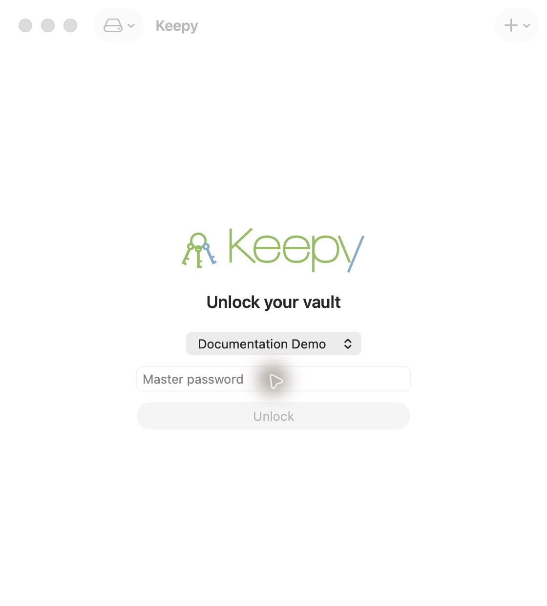
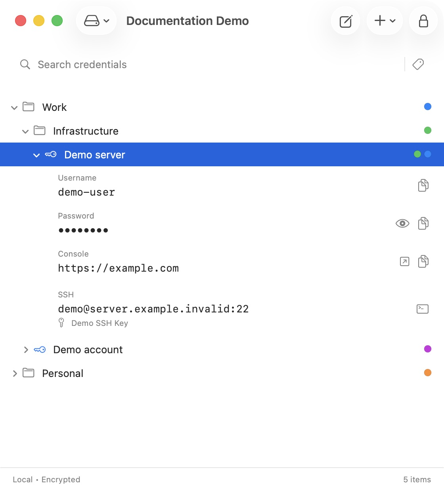
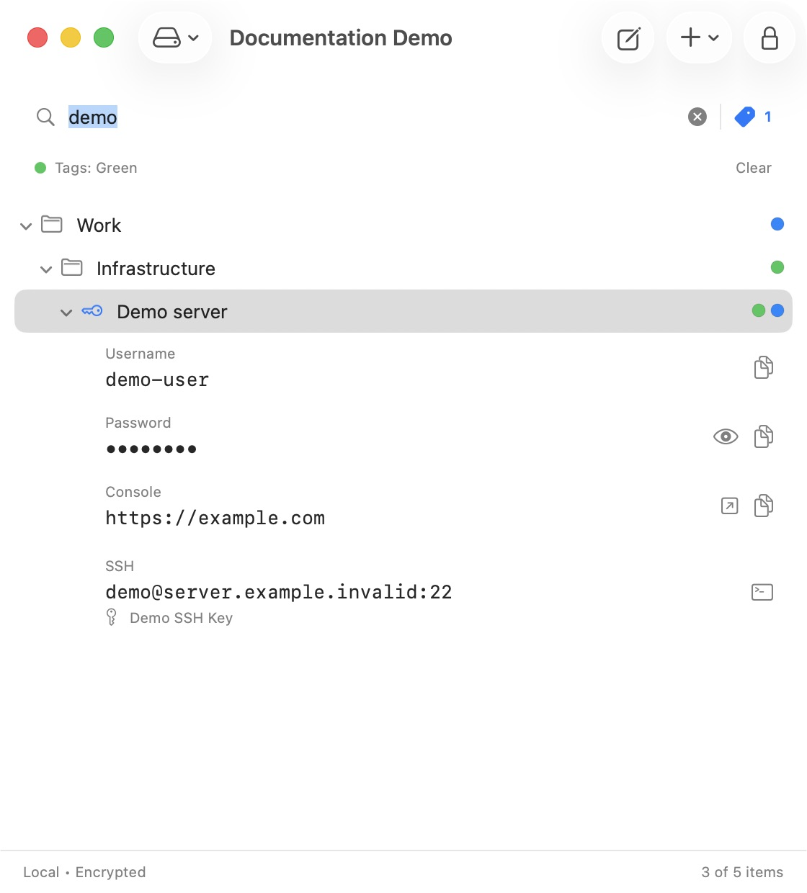
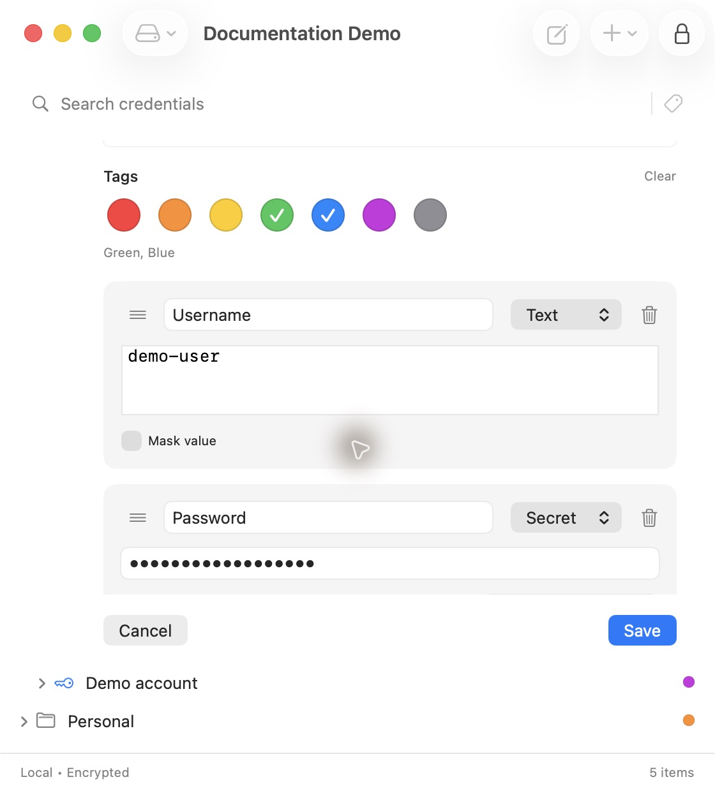
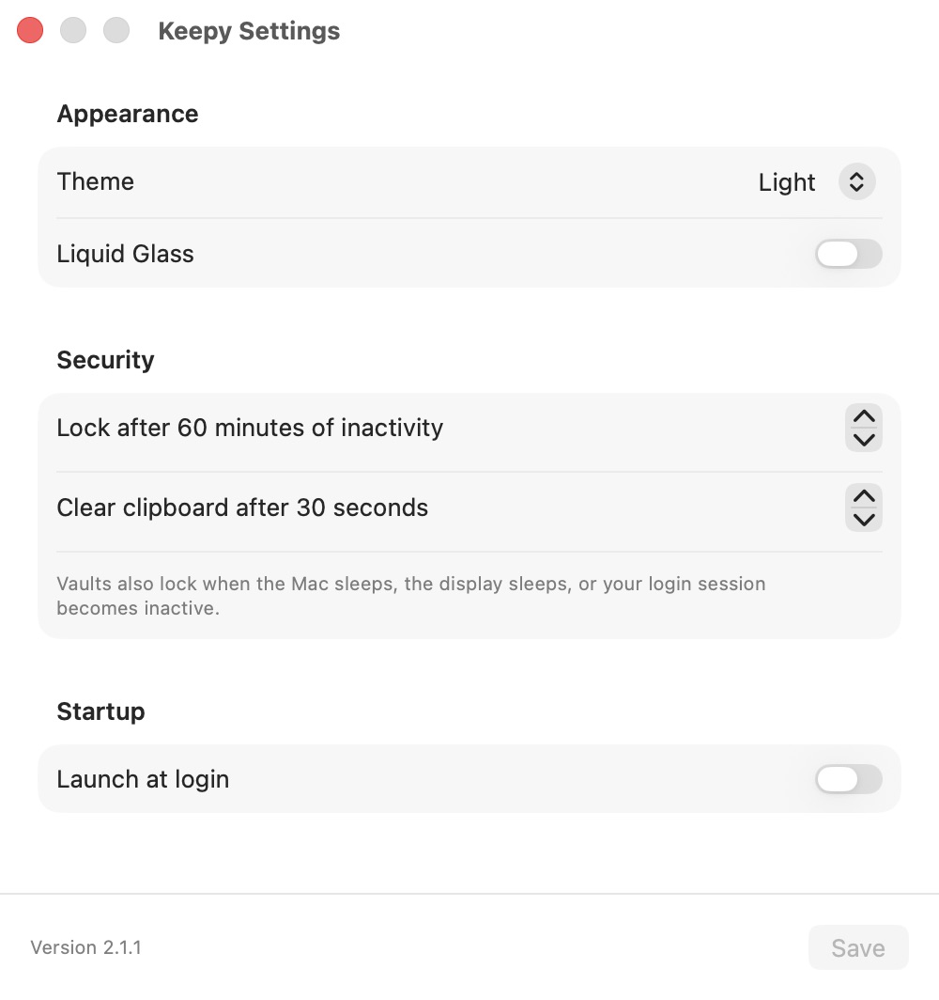

# User guide

Keepy 2.2.2 requires macOS 14+. All credential data stays on your Mac.

## Vaults and navigation

On first launch, enter a vault name and a master password of at least eight
characters, then confirm it. There is no password recovery. Existing vaults
appear in the unlock screen: choose one, enter its password, and press Return.
Create another through File → New Vault or the toolbar’s + menu.
Switching vaults locks the current one and requires the next vault's password.

*Select a vault and enter its master password. This is a synthetic demo vault.*

One compact tree contains nested groups, entries and their fields. Use the disclosure triangles
and arrow keys to navigate. Return expands or collapses a group or entry. Double-click an entry to edit it. Command-E edits
the selection. Right-click for field actions, editing and deletion. The toolbar’s + menu is
the single on-screen place to create entries, groups and vaults. Backspace requests
confirmation before deleting a selected item and its contents.

Command-N creates an entry and Shift-Command-N creates a group. New items use
the selected group, or the selected entry's parent, as their destination.
Drag a tree item onto a group to move it inside, or between rows to reorder.
Moves that create cycles are rejected. Search matches names, labels, visible
values, and SSH connection metadata. Masked values are excluded. Clear search
and tag filters before rearranging the tree so all destination positions are
visible.

## Touch ID

On a Mac with enrolled Touch ID, a provisioned signed build can unlock each
vault using biometrics. Unlock with the master password first, then choose
Vault → Touch ID… (also available in the toolbar's vault menu). Enter the current
master password, choose Enable Touch ID, and approve the native macOS prompt.
Enrollment is complete only after a biometric-protected Keychain read succeeds.

After locking, select that vault and choose Unlock with Touch ID. Every unlock
requires a fresh native authentication. Cancelling leaves the vault locked;
the password field remains available. No prompts appear automatically. To remove
the enrollment, unlock the vault and choose Disable Touch ID in the same dialog.

Enrollment belongs to this vault on this Mac and is not synchronized or included
in a vault backup. Renaming the vault retains enrollment. Changing its password
protection invalidates the old enrollment; unlock with the current master
password and set up Touch ID again. Adding or removing enrolled fingerprints
also invalidates the protected Keychain item. If Touch ID is locked or otherwise
unavailable, use the master password. This is not password recovery: keep the
master password available separately, including for older backups.

Ad-hoc builds do not have the provisioning needed for biometric Keychain access.
Their Touch ID dialog explains the limitation and password unlocking continues
to work. Hover over the Touch ID menu item or the dialog's information icon to
see an explanatory tooltip. See [Touch ID design and verification](TOUCH_ID.md) for signing setup
and release checks.

## Colored tags and filtering

*Expand an entry to see its fields in the same tree as its parent groups.*

Groups and entries can carry several colored tags: Red, Orange, Yellow, Green,
Blue, Purple, and Gray. Tags appear next to each item's name and stay with the
item after renaming, editing, or moving it. Tags are stored inside the encrypted
vault; existing items start with no tags.

Choose colors under Tags in the group or entry editor, then Save. Use Clear to
remove all draft tags. Right-click an existing item and open Tags to toggle a
color immediately or choose Remove All Tags.

Open Filter by Tags beside the search field and select one or more colors. An
item matches if it has any selected color. A tagged group includes its
descendants, while parent groups remain visible to preserve the location of
matching entries. Press Shift-Tab from the search field or vault tree to open
the filter using the keyboard. Use the arrow keys to move between colors and
Return to toggle the highlighted color; the popover stays open for selecting
several tags. Tab and Shift-Tab also navigate the palette. When filters are
selected, Clear Tag Filters follows Gray and can be activated with Return.
Escape closes it and returns focus to the control that opened it.
The initial highlight is the first selected color, or Red when no filters are
selected. These controls also work after opening the filter with the mouse.

Combine tag filtering with text search to narrow those results: a displayed item must
also match the search, or contain a descendant that does. Search still excludes
masked values; a group-name search keeps the matching subtree. Clear filters
from the filter popover or active-filter strip to show the full tree again.
Locking or switching vaults clears both search and selected filter colors.

*Combine text search and colored tags while keeping the matching entry's location visible.*

## Entries and fields

Expand an entry to see its fields directly beneath its name. Click a value or its Copy button to copy it.
The eye explicitly reveals or hides a masked value. The URL button opens a
validated HTTP(S) address in your default browser. Select fields with the
keyboard: Return copies Text/Secret fields, opens URLs, or connects SSH fields.

Drag a field between its siblings to reorder it without revealing secrets.
Use Edit to change the name, field labels, kinds, values, and masking. Text,
Secret, URL, and SSH are supported. Secret defaults to masked; Text and URL can
also be masked. Text values support multiple lines. In the editor, drag the grip
to reorder fields, use the trash button to remove one, and Add Field to add one.
Drag Move draft into the tree to choose a destination for an unsaved entry
or group. You can also drag the draft’s tree row. The inline editor stays open with all unsaved values. Save encrypts
and persists the complete edit. Cancel discards the draft; edited entries and
groups request confirmation before discarding changed names, fields, ordering,
or tags.

*Choose a field type and masking independently. The secret stays masked while editing.*

Vault → SSH Keys lets you paste or import named OpenSSH private keys. Existing
keys display their algorithm, fingerprint and encryption status. Leave the key
box empty when renaming a key; a replacement keeps all connection references.
A referenced key cannot be deleted until its SSH fields are removed or updated.
SSH fields store user, host, optional port and a key reference. The Terminal
button launches the system OpenSSH client through an ephemeral one-key agent.
Encrypted OpenSSH keys request their passphrase for each connection. Host-key
confirmation and server prompts remain in Terminal. SSH failures stay visible
until Enter is pressed. Agents stop on locking, exit or their bounded timeout.

File → Import YAML (Shift-Command-I) opens the native file picker and imports
nested groups and entries into the unlocked vault. The importer identifies
password-like values and URLs automatically. Existing contents are retained.

## Settings and desktop behavior

Open Settings with Command-Comma. Choose System, Light or Dark appearance.
On macOS 26+, Liquid Glass enables a translucent background across the main and
Settings windows, including the title bar, and native glass surfaces. The
background blurs content behind the window while text and controls remain
sharp. Disabling Liquid Glass or enabling macOS Reduce Transparency restores
an opaque window. Native system controls retain their macOS styling.

Set inactivity locking between 1 minute and 24 hours, and clipboard clearing
between 5 seconds and 1 hour. Clearing applies only while the clipboard still
belongs to the app; copying unrelated content prevents its removal. The vault
also locks when the Mac or display sleeps or the login session becomes inactive.
Shift-Command-L locks immediately. Closing the window keeps the app in the menu
bar. The menu bar offers Open, Lock, Settings and Quit; quitting locks first.
Launch at login uses macOS Login Items and starts hidden in the menu bar. If macOS requires approval, Settings
provides a link to the system Login Items page.

*Choose System, Light, or Dark in Theme; Liquid Glass is a separate option on macOS 26+.*

## Backups

Back up the entire `~/Library/Application Support/Keepy/` directory,
including config.json and vaults. Vault display names and preferences in the
registry are unencrypted; all vault contents and SSH key documents are encrypted.
Keep each master password available separately. Copying only a vault file does
not preserve the registry. There is no cloud backup or recovery service.
